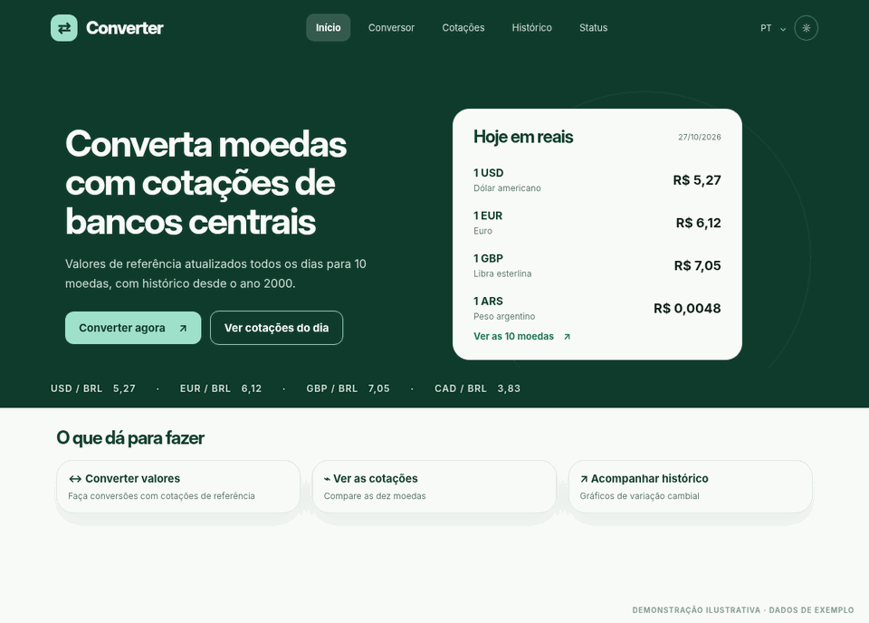

<div align="center">


# currency-converter-web

Site do Converter: conversor de moedas, cotações do dia e histórico desde 2000, nos temas claro e escuro.

</div>

O site consome a [currency-converter-api](https://github.com/aqu1no1/currency-converter-api), que guarda as cotações diárias de bancos centrais sincronizadas da [Frankfurter](https://frankfurter.dev). Ele não chama o provedor diretamente: tudo passa pela API.

Moedas suportadas: USD, BRL, EUR, GBP, JPY, CAD, AUD, CHF, CNY e ARS. Textos em português, inglês e espanhol, com valores, taxas e datas formatados no idioma ativo.

## Demonstração

<div align="center">
  
</div>

## Stack

<p>
  
  
  
  
  
  
  
</p>

A lista completa, com versões e o uso de cada tecnologia, está em [docs/stack.md](docs/stack.md).

## Documentação

| Página                      | O que tem                                                  |
| --------------------------- | ---------------------------------------------------------- |
| [Stack](docs/stack.md)      | Todas as tecnologias, separadas por área, com versão e uso |
| [CI e releases](docs/CI.md) | GitHub Actions, CHANGELOG e como lançar uma versão         |
| [CHANGELOG](CHANGELOG.md)   | O que mudou em cada versão                                 |

## Como rodar

### Pré-requisitos

- Node.js 24
- pnpm 12 (versão no campo `packageManager` do `package.json`; `corepack enable` já disponibiliza)
- A [currency-converter-api](https://github.com/aqu1no1/currency-converter-api) rodando, com `CORS_ORIGINS=http://localhost:5173` no `.env` dela

### Passo a passo

```bash
# 1. Variáveis de ambiente
cp .env.example .env   # ajuste VITE_API_URL se a API não estiver em http://localhost:3000

# 2. Dependências
pnpm install

# 3. Site
pnpm dev
```

O site sobe em `http://localhost:5173`. Para conferir a versão de produção:

```bash
pnpm build
pnpm preview
```

### Variáveis de ambiente

| Variável       | Descrição       |
| -------------- | --------------- |
| `VITE_API_URL` | URL base da API |

Toda variável nova entra no `.env.example` e no `src/types/env.d.ts`. Variáveis `VITE_*` vão para o bundle, então nada secreto nelas.

## Páginas

| Rota         | Página                  | O que tem                                                                                  |
| ------------ | ----------------------- | ------------------------------------------------------------------------------------------ |
| `/`          | Início                  | Cotações de hoje em reais, faixa de cotações, o que dá para fazer e as moedas suportadas   |
| `/converter` | Conversor               | Valor, moedas De e Para com inverter, taxas direta e inversa e conversões frequentes       |
| `/rates`     | Cotações do dia         | Moeda base à escolha e tabela com quanto ela vale em cada moeda; a linha abre o histórico  |
| `/history`   | Histórico               | Gráfico do ApexCharts em 7 dias, 30 dias ou 1 ano, variação, mínima, máxima e mais recente |
| `/status`    | Status da sincronização | Última sincronização, data das cotações, histórico desde 2000 e a tabela de execuções      |
| `*`          | 404                     | Página não encontrada, com atalhos para o início e o conversor                             |

O estado de cada página fica na URL, então dá para compartilhar o link: `/converter?amount=100&from=EUR&to=BRL`, `/rates?base=EUR` e `/history?from=USD&to=BRL&period=30d`.

### Estados de erro

A regra é a mesma do app: se há dados na tela, a página continua e mostra só um aviso; o estado de erro ocupa o conteúdo só quando não há nada para mostrar. Cabeçalho e rodapé ficam sempre.

| Estado                     | Quando aparece                                       |
| -------------------------- | ---------------------------------------------------- |
| API indisponível           | Erro de rede, timeout ou 5xx sem dados para mostrar  |
| Cotações a caminho         | A API responde `503` antes da primeira sincronização |
| Atualização falhou         | A última sincronização falhou; aviso acima da tabela |
| Sem cotações nesse período | O histórico do par no período veio vazio             |
| Algo deu errado            | Uma página quebrou ao renderizar (erro 500)          |
| Página não encontrada      | Rota que não existe (404)                            |

O erro da API é mapeado num lugar só (`src/utils/error-state.util.ts`) e desenhado pelo `QueryErrorState`.

## Scripts

| Script                              | O que faz                                                      |
| ----------------------------------- | -------------------------------------------------------------- |
| `pnpm dev`                          | Servidor de desenvolvimento do Vite                            |
| `pnpm build`                        | Typecheck e build de produção em `dist/`                       |
| `pnpm preview`                      | Serve o `dist/` localmente                                     |
| `pnpm lint` / `pnpm lint:fix`       | Lint com oxlint                                                |
| `pnpm format` / `pnpm format:check` | Formatação com oxfmt                                           |
| `pnpm typecheck`                    | Checagem de tipos do app, da config e dos testes               |
| `pnpm test`                         | Todos os testes                                                |
| `pnpm test:watch`                   | Testes em modo watch                                           |
| `pnpm test:cov`                     | Testes com cobertura                                           |
| `pnpm pr`                           | Lint, formatação, typecheck, testes com cobertura e build (CI) |

## Testes

```bash
pnpm test         # todos os testes, sem rede: a API é sempre simulada
pnpm test:cov     # com cobertura
```

| Tipo                            | Testes | O que cobre                                                                                       |
| ------------------------------- | ------ | ------------------------------------------------------------------------------------------------- |
| Unitário (`test/unit`)          | 88     | Utils (formatação, taxas, histórico, datas), services, hooks, i18n, tema e query client           |
| Componentes (`test/components`) | 29     | Componentes compartilhados: botões, chips, tabelas, seletor de moeda, idioma, tema e cabeçalho    |
| Integração (`test/integration`) | 37     | Páginas inteiras com a API simulada: digitar, trocar moeda e período, paginação e estados de erro |

- Os testes usam Vitest com Testing Library e jsdom
- Nenhum teste chama a API de verdade: o `createFakeApiService` (`test/utils/`) entra no lugar do Axios, e o `respondByUrl` responde por URL
- O gráfico do ApexCharts não roda no jsdom, então os testes do Histórico usam um gráfico falso e conferem os números e o resumo para o leitor de tela

## Estrutura

```
src/
├── pages/        # uma pasta por página; componentes só da página em pages/<pagina>/components/
├── routes/       # App e AppRoutes (caminhos em constants/routes.constants.ts)
├── components/   # componentes usados em duas páginas ou mais, por grupo
├── contexts/     # providers do React (ApiProvider)
├── hooks/        # hooks de dados (TanStack Query) e de UI
├── services/     # apiClient do Axios + uma classe por recurso da API
├── theme/        # ThemeProvider + useTheme
├── styles/       # index.css: Tailwind, tokens do tema e @theme
├── constants/    # rotas, moedas, períodos, ícones e tempos
├── dtos/         # schemas Zod das respostas da API
├── interfaces/ · enums/ · models/
├── utils/        # funções puras (formatação, taxas, histórico, erros)
├── lib/          # query-client e i18n
├── locales/      # pt-BR, en e es
├── types/        # declarações globais (env.d.ts)
└── assets/       # logo e ícones
public/           # favicons, manifest
test/             # unit, components, integration, setup, fixtures, utils
```

As camadas têm papéis fixos:

```
página ──► cria os services com useApi() + useMemo
   │
   ├──► hooks (TanStack Query) ──► service ──► apiClient (Axios) ──► API
   │                                   └── resposta validada pelo Zod
   └──► componentes: só apresentação, recebem tudo por props
```

Nomes de pastas, arquivos, componentes, rotas e chaves de tradução ficam sempre em inglês; português só nos textos de `locales/pt-BR`. Imports entre pastas usam os aliases (`@components/*`, `@utils/*`...), e o oxlint barra imports relativos.

## Planejamento no Linear

O site foi planejado e acompanhado no Linear: [Web Converter](https://linear.app/api-converter/project/web-converter-1d060952b828). Os links abrem só para quem tem acesso ao workspace.

**Tasks, por milestone**

| Milestone              | Task                                                                                                                                                                                                      |
| ---------------------- | --------------------------------------------------------------------------------------------------------------------------------------------------------------------------------------------------------- |
| 1. Setup e organização | [API-54](https://linear.app/api-converter/issue/API-54/criar-o-projeto-web-com-vite-react-e-pnpm-e-montar-a-estrutura-de) Criar o projeto web com Vite, React e pnpm e montar a estrutura de pastas       |
|                        | [API-55](https://linear.app/api-converter/issue/API-55/configurar-oxlint-oxfmt-vitest-ci-pipeline-de-release-e-template-de-pr) Configurar oxlint, oxfmt, Vitest, CI, pipeline de release e template de PR |
| 2. Base da web         | [API-56](https://linear.app/api-converter/issue/API-56/tema-claro-e-escuro-na-web-com-tailwind-e-variaveis-css) Tema claro e escuro com Tailwind e variáveis CSS                                          |
|                        | [API-57](https://linear.app/api-converter/issue/API-57/traducoes-com-i18next-na-web-pt-br-en-e-es) Traduções com i18next (pt-BR, en e es)                                                                 |
|                        | [API-58](https://linear.app/api-converter/issue/API-58/camada-de-api-na-web-apiservice-services-dtos-e-hooks-com-tanstack) Camada de API: ApiService, services, DTOs e hooks com TanStack Query           |
|                        | [API-60](https://linear.app/api-converter/issue/API-60/layout-da-web-cabecalho-rodape-rotas-e-assets) Layout: cabeçalho, rodapé, rotas e assets                                                           |
|                        | [API-61](https://linear.app/api-converter/issue/API-61/componentes-compartilhados-da-web) Componentes compartilhados                                                                                      |
| 3. Páginas             | [API-62](https://linear.app/api-converter/issue/API-62/pagina-home) Página Home                                                                                                                           |
|                        | [API-63](https://linear.app/api-converter/issue/API-63/pagina-conversor) Página Conversor                                                                                                                 |
|                        | [API-64](https://linear.app/api-converter/issue/API-64/pagina-cotacoes-do-dia) Página Cotações do dia                                                                                                     |
|                        | [API-65](https://linear.app/api-converter/issue/API-65/pagina-historico-com-grafico-do-apexcharts) Página Histórico com gráfico do ApexCharts                                                             |
|                        | [API-66](https://linear.app/api-converter/issue/API-66/pagina-status-da-sincronizacao) Página Status da sincronização                                                                                     |
| 4. Erros e publicação  | [API-67](https://linear.app/api-converter/issue/API-67/estados-de-erro-da-web-404-e-500) Estados de erro, 404 e 500                                                                                       |
|                        | [API-68](https://linear.app/api-converter/issue/API-68/publicar-o-site-web) Publicar o site                                                                                                               |

Cada task tem contexto, o que fazer e critérios de aceite, e o link do PR que a entregou.

## Fonte dos dados

As cotações vêm da [currency-converter-api](https://github.com/aqu1no1/currency-converter-api), que sincroniza todos os dias da [Frankfurter v2](https://frankfurter.dev): cotações de bancos centrais e fontes oficiais, com histórico desde 2000. São taxas médias de mercado, só para referência: não incluem spread nem tarifas.
